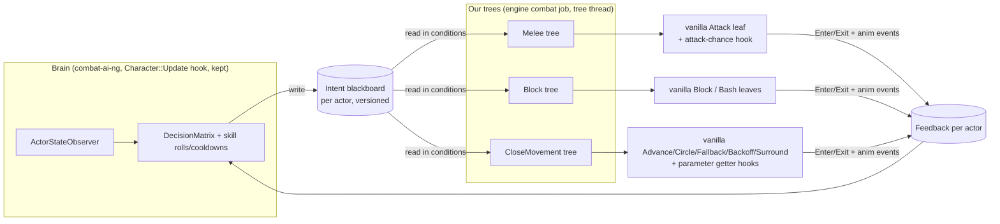

# In-tree combat AI: design (draft 1, 2026-10-22)

Goal: fork **combat-ai-ng** (D:\Modding\combat-ai-ng, MIT) into a new mod. Keep its decision code
(observers, `DecisionMatrix`, the level-scaled skill rolls + cooldowns that still live in class
`Humanizer`, config, menu). Replace its actuator (`ActionExecutor`: raw
animation events and graph variables) with **our own behavior trees**, built from vanilla node
classes the way **FenixCombatAI-NG** (D:\Modding\skyrim_mods\FenixCombatAI-NG) does. Vanilla
leaf nodes then execute every action.

Out of scope for now: SCAR/MCO/BFCO/CPR/Precision/TK Dodge compatibility, VR.
Targets: **SE 1.5.97** and **AE 1.7.104** (1.6.1170 for free, because Fenix-NG is validated there).

Labels: **C** confirmed (binary or runtime), **L** likely, **U** unverified.

## 1. Why in-tree

| Problem with combat-ai-ng today | In-tree answer |
|---|---|
| Raw `attackStart`/`blockStart`/`bashStart` skip `TESActionData` and attack-data choice (RE §4.5, run 2) | Vanilla Attack/Block/Bash leaves fire the real action with the chosen attack data **C** |
| No arbitration: the vanilla tree keeps firing, and Block exit sends `blockStop` over ours (`46635`/`46630`) **C** | Our tree **is** the tree. Vanilla's Action/Movement resources arbitrate **C** |
| `Speed`/`Direction`/`Input*` writes are overwritten (FluidMotionNPC hooks `ActorSpeedChannel` for exactly this reason) **L** | Movement leaves (Advance/Circle/Fallback/Backoff/Surround/Reposition) drive `CombatPath` **C** |
| Vanilla helpers need the tree-thread TLS (#11) **C** | Conditions run inside tree threads, so StartAttack and CombatStyle getters are usable |

What it costs: actions are limited to vanilla leaf classes until we write our own leaf class (§6).
It conflicts with any mod that replaces the same tree constructors (FenixCombatAI, the original
combat-ai-ng). A mod that patches the same leaf code also conflicts if we install movement patches (CPR).

## 2. Architecture



- **Brain:** unchanged combat-ai-ng code. It stops calling `ActionExecutor::Execute` and writes an
  `Intent` instead.
- **Intent blackboard:** a `ThreadSafeMap<FormID, Intent>` (the class already exists in combat-ai-ng).
  It is written on the update thread and read by tree threads running in parallel combat jobs.
  Every intent has an `expires` time, so a stale intent falls back to "no opinion".
- **Feedback:** leaf Enter/Exit and animation events (`attackStop`, `HitFrame`, `blockStop`,
  `bashStop`) report what actually ran, so the brain stops guessing.

```cpp
struct Intent {                    // one per actor, replaced whole on every brain decision
    enum class Attack : uint8_t { None, Light, Power, Sprint } attack;
    enum class Defend : uint8_t { None, Block, TimedBlock, Bash } defend;
    enum class Move   : uint8_t { Vanilla, Advance, Circle, Fallback, Backoff, Surround, Hold } move;
    float circleAngleDeg, holdDistance, fallbackDistance;   // feeds the movement getter hooks
    float expires;                 // AI time; past it the trees behave as Intent{} (vanilla-like)
    uint32_t seq;                  // bumps each write; feedback echoes it
};
```

## 3. Mapping combat-ai-ng actions to tree nodes

| combat-ai-ng `ActionType` | Tree / node | Mechanism |
|---|---|---|
| Attack, PowerAttack | Melee: `Attack` leaf behind a selector gate | Gate condition = `intent.attack != None`. The attack-chance hook (SE 48139+0x2AE / AE 49170+0x28D → 49748/50675, combat-ai-ng already hooks it) returns 0 for attack data that doesn't match Light/Power **C** (site), **U** (forcing power reliably) |
| SprintAttack | Melee `Attack` + sprint-attack data | **U**: whether the Attack node picks sprint attack data while sprinting. Fenix-NG has a `PolicySprintAttackCanary`; read it first |
| Bash, Parry | Block tree: `Bash` leaf gated by `intent.defend == Bash` | Fenix-NG `Block_wantbash` pattern, runtime-proven on AE 1.6.1170 |
| TimedBlock | Block tree: `Block` leaf gated by `intent.defend ∈ {Block, TimedBlock}` | Block's own Exit sends `blockStop`; release = intent cleared. Idle weight 0.25 s, the vanilla value (Fenix found 1.0 too slow) |
| Advancing | CloseMovement: `Advance` | Situation gated by `intent.move == Advance` |
| Strafe | CloseMovement: `Circle` | Angle/radius through `getCircleAngle` (49721/50648) and the `setTwoRadiuses` hook (Fenix Section C) |
| Retreat | CloseMovement: `Fallback` | Distance and wait through `getFallbackDistance`/`getFallbackWaitTime` (49718/50645, 49719/50646) |
| Backoff | CloseMovement: `Backoff` | — |
| Flanking | CloseMovement: `Surround` | Nearest vanilla equivalent; **L** semantics |
| Dodge, ForwardDodge, Jump, Feint | **none in v0.1-0.2** | Needs our own leaf class (§6). Until then these actions are disabled |

`Intent::Move::Vanilla` keeps vanilla's own CloseMovement selection, so v0.1 can ship without the
movement tree.

## 4. Trees (as built in 0.1.0)

0.1.0 uses vanilla's own shape (FallbackSelector<NextChildSelector> with RandomNode children)
instead of Fenix-NG's ValueNode/ConditionalChildSelector shape. A RandomNode with a probability of
1 or 0 works as an intent gate, and with vanilla's chance function it is the stock branch. The
RandomNode factory (SE 46641 / AE 47845) builds `ConditionalNode<RandomBoolChance(f(Attacker, Target))>`,
RTTI-checked on 1.7.104, the same class as vanilla's "RandomNode - Attack".

```text
Melee : Melee Context(slot 0) > Repeat > NextSelector{
          RandomNode(intent attack: 1/0) > Attack
          RandomNode(vanilla 49749/50676, rescaled) > Special Attack
          RandomNode(vanilla 49747/50674, rescaled) > Attack
          Idle(0.05 s) }
Block : Block Context(slot 1) > Repeat > NextSelector{
          RandomNode(intent bash) > Bash
          RandomNode(intent block) > Block > RandomNode(vanilla bash 49755/50682) > Bash
          RandomNode(vanilla 49750/50677, rescaled) > Block Attack > RandomNode(vanilla bash) > Bash
          RandomNode(vanilla 49756/50683, rescaled) > Offensive Bash
          RandomNode(vanilla 49751/50678, rescaled) > Block > RandomNode(vanilla bash) > Bash
          Idle(0.05 s) }
```

- Vanilla branches return 0 while an intent is pending, so they never jump in front of the brain.
- The Idle hold is 0.05 s instead of vanilla's 0.25 s (otherwise a timed block could start up to 0.25 s late).
  To compensate, vanilla chances are rescaled as `1-(1-p)^(0.05/0.25)`, which keeps the per-second rate unchanged.
- Block Context's equip slot is 1, as in vanilla (Fenix-NG writes 0).
- Before allocating, the node pool is initialized the way vanilla builders do it (flag SE 514112 / AE 400190). Fenix-NG skips this step.
- In 0.1.0 the executor is unchanged for movement, dodge, jump, feint, forward dodge and sprint attack (the old actuator).
  Attack and power attack still send a raw `blockStop` when the actor is blocking (old `Execute()` preamble).
## 5. Port status of Fenix-NG's offsets (checked 2026-10-22, `re/fenixport.py`)

Each AE 1.6.1170 ID in Fenix-NG `src/Offsets.h` was compared with AE 1.7.104. Function bodies were
compared as normalized instructions, with call and rip targets mapped to Address Library IDs.

| Result | Items |
|---|---|
| **Identical** | Tree machinery: `ctorNonvirtual`, `nodeAllocInit`, `nameNode`, `initNodes`, `addFirstChildren`, `initChildrensParents`, every node factory, `Conditional2_new`, `RandomNode0_new`, `GetLocaleT`, `isOutOfRangeCtx`, `shouldFallbackToRangedCtx`, `CombatAIGetMe/Target`. **All three tree constructors** (Melee 49182, Block 47843, CloseMovement 47928). `AttackChanceCaller` (+0x28D is valid). `CircleUpdate`, getters, `AttackUpdate`, `AdvanceAct`. **All 24 vtables** (same RTTI class, same 12 slots). `nodePool` data |
| Patch sites still valid | `FallbackUpdate` (+0xF8/+0x114/+0x128/+0x138/+0x227/+0x242), `FallbackWaitHost` +0x12E, `AdvanceRadiiHost` +0x127: the same instructions sit at the same offsets |
| **ID changed in 1.7.104** | `isMovingFrom` AE 47326 does not exist in 1.7.104. The same code is ID **523984** (FallbackUpdate+0x11B now calls it). An AE-only `RelocationID` would crash at load: map it per build |
| Code changed (only called, not patched) | `nodeAllocator` (register allocation only), `isStaggered` (one extra instruction), `checkCollisions`, `getFallbackSpeed` (jump-table data), `FindStandardLocationBody` |

SE IDs come from Fenix's original SE work. We haven't re-verified them with our SE tools yet (to do before the first SE build).

## 6. Our own leaf class (built in 0.18.0 as the DualBlock node; dodge/jump/feint still not, see below)

Dodge, jump and feint would need a leaf node that holds the tree's resource while the action plays.

**Slot map (from `CombatBehaviorThread::Update` 46228/47483, 2026-10-22).** The labels from the original
RE doc are right. CPR's names (act/pop/on_childfailed/on_interrupted) misdescribe slots 3-5. An earlier
"correction" adopting the CPR names was wrong and has been retracted.

| Slot | Called | Evidence |
|---|---|---|
| 0 | destroy(bool free) | |
| 1 | get_name | |
| 2 | Enter: once, when the thread descends into the node (state 2) | Thread::Update +0xB4 |
| 3 | Exit: on the node that just ascended, same tick; frees its stack frame | +0x104; Circle 46843 frees 0x10, Idle 32436 frees 8 |
| 4 | Update: every tick while running (state 1, not paused/suspended, failState != 2) | +0xDB; Circle 529966 → 46721 |
| 5 | Abort: instead of 4 while failState == 2 | +0xE0; movement leaves and Idle = bare Ascend |
| 6 / 7 | SaveGame / LoadGame | |
| 8 | bool validate | Idle → CombatBehaviorAction::Validate 529913 |
| 9 | ? | |

**State reservation is solved.** Idle's Enter (32430) builds its own 8-byte frame from the hold at
node+0x28 (via 32404), its Exit pops it, and its Update runs the timer. A leaf that is an Idle node with
a copied vtable, whose slot 2 does its work and then calls Idle's slot 2, inherits all of that. No probe
is needed.

**Why it is not built.** TK Dodge and the jump are animation-graph events, not engine actions. A tree
leaf would fire the same events, just later: the leaf runs on the tree thread, so the event must be
queued to the main thread. That is a tree tick plus up to a frame after the brain decides, on the
reaction-critical action. The executor would also lose its synchronous success result, which feeds
cooldowns and stamina. The only gain is that the tree holds its resource during the dodge, so vanilla
movement or attack nodes can't start mid-dodge, and no run so far has shown that problem. Build it if a
log or video shows movement fighting a dodge. With 0.4.0 our running move does stop within the 0.4 s move-intent TTL once
the brain picks a dodge, because the dodge doesn't refresh the move.
## 7. Roadmap

| Version | Content | Pass criteria (runtime, AE 1.7.104) |
|---|---|---|
| 0.1.0 | Fork. Intent blackboard. Melee + Block trees. Attack-chance hook driven by intent. `ActionExecutor` attack/block/bash paths removed; movement left vanilla | Marked bandit attacks, power attacks, blocks and bashes only when the brain says so (probe-verified); no crash for 10 min; save/load in combat OK |
| 0.2.0 | **Done (build):** our branches spliced above the vanilla Movement Selector via a hook on its SetRoot call; Advance/Circle/Fallback/Backoff; Flanking = Circle; Surround and parameter getters deferred | Strafe/retreat/advance visibly follow the intent; no movement-tree freeze |
| 0.2.x | Movement preemption (vanilla DynamicSelector RE) + parameter getters (circle side/radius, fallback distance) | brain changes take effect within ~0.25 s |
| 0.3.0 | Feedback channel to the brain (leaf Enter/Exit, anim events) | The brain stops reissuing actions that already run |
| 0.4.0 | Own leaf class: dodge / jump / feint | after §6 is resolved |

## 8. Open items before coding 0.1.0

1. Read Fenix-NG `Conditions.cpp` (attack gate, block gate, attack chance) and
   `PolicyAttackLifecycle.cpp` / `PolicySprintAttackCanary.cpp`, and keep what applies to an intent-driven gate.
2. Check that forcing Light vs Power through the attack-chance hook always yields an attack and never leaves an empty attack
   context. Fenix-NG's SCAR crash came from a fully-declined candidate set; the same risk exists in vanilla. **U**
3. Verify Fenix's SE IDs with our SE tools (`fenixport.py` dump for SE plus a name/RTTI check).
4. Thread model: confirm where `Character::Update` runs relative to the combat jobs (main thread
   or job). This decides whether the blackboard needs only atomics or a lock. **U**
5. Name and folder for the fork.

## 9. Movement preemption (0.4.0, built)

Problem: a running movement node (Circle, Fallback, Advance, Backoff) ran to its own end before a new
brain decision could take effect.

**How (no new tree nodes):** the four movement classes' slot 4 (Update) is hooked through their vtables
(Id::vtAdvance/vtCircle/vtFallback/vtBackoff). The hook acts only on nodes below one of our Intent
Movement Selectors (parent-chain walk, depth ≤ 12):
- our branch's node (direct child of our RandomNode): stops once `Intents::WantedMove` is no longer its kind;
- a vanilla node under our selector: stops when the brain wants any move, so our branch can take over.

Stopping means `CombatBehaviorThread::Ascend()` instead of Update. That is exactly what the classes' own
slot 5 (Abort) does, and CPR's AdvanceInterruptHook ends Advance from slot 4 the same way (with
SetFailed first). The engine then calls the node's slot 3, which frees its frame, and the selector
re-reads the intents on the next tick. A node must have run 0.3 s before it can be stopped, so brain
flip-flops can't stutter the feet.

Not touched: movement nodes in any other tree. The older options (our branches as ValueNode children of
`Root - Movement`'s DynamicSelector, or our own DynamicSelector) stay unbuilt. Both still have the
ValueNode "children belong to the wrapper" risk, and neither is needed.

Feedback: the 60 s summary adds `running moves stopped: ours N, vanilla N`; the debug actor logs
`Move 0x..: stopped running our/vanilla node K (brain wants move W)`.

## 10. Vanilla movement leaves: when they move (RE, SE 1.5.97, 2026-10-22)

Each leaf is called by `CombatBehaviorThread::Update` (46228 / 47483) as `(node, thread)`: Enter slot 2, Exit slot 3, Update slot 4, Abort slot 5. No return value is used (SE, AE 1.6.1170, 1.7.104). `range` below is `CombatInventory+0x1A0`; `inner` comes from `set_two_radiuses` 49716. GameSetting defaults come from the exe's `.data`, overridden by `Skyrim.esm` where noted.

| Leaf | Starts only if (Enter) | Ends when (Update) | Moves to |
|---|---|---|---|
| Backoff 46724 / 46725 | target not moving away (46062), self not 36487, target inside view cone (36756, data 265582), **dist < `fCombatBackoffMinDistanceMult` 0.75 × (range + inner)** | path done/failed, or 46063 | the ring at `range + inner`: a short step, only from inside it |
| Circle 46720 / 46721 | target within `fCombatCircleViewConeAngle` 150; angle from `get_CircleAngle` 49721 (`fCombatCircleAngleMin/Max` 30/90); move ≥ `fCombatCircleMinMovementDistance` 64 | dist > range + `fCombatCircleDistanceMax` 1024, dist < `fCombatCircleMinDistanceMult` 0.5 × range, or path done | an arc point at the current radius |
| Advance 46703 / 46704 | path to target | `CheckShouldStop` 46698 (in place) | the `inner`/`outer` radius band (`fCombatAdvance*Radius*`; esm: InnerMax 256, OuterMin 128, OuterMid 256, OuterMax 512) |
| Fallback 46712 / 46713 | `get_FallbackDistance` 49718 (`fCombatFallbackDistanceMin/Max` 96/256), move ≥ `fCombatFallbackMinMovementDistance` 64 | path done, wait `get_FallbackWaitTime` 49719 | a point behind it |

When a start condition fails, Enter calls `SetFailed(true)` (46240) and `Ascend` (46229), so the node exits on the next tick having done nothing. This is why the run 11 audit shows Backoff "still": the brain asks to back off at distances where the vanilla node won't move.

**0.8.0:** for our branch only, Backoff/Fallback start checks are patched (facing, moving-away pass; X = dist - range + step). See CHANGELOG 0.8.0 and VALIDATION 0.8.0 for the sites.
